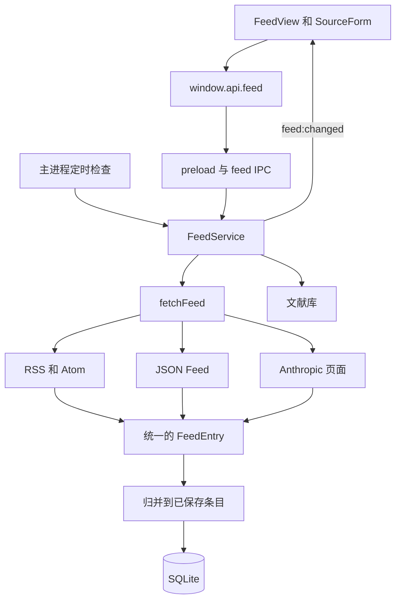

# Feed 实现说明

Feed 用于追踪论文和实验室博客，完成“添加来源 → 自动抓取更新 → 阅读正文或摘要 → 加入文献库”的流程。支持 RSS、Atom、JSON Feed、arXiv 查询以及 Anthropic 官网列表页，内容和阅读状态保存在工作区的 SQLite 数据库中。

本模块对应[板块 1 用户需求](用户需求/LB-USR-1.md)的 LB-USR-1-1 至 1-22、1-28 和 1-29，订阅分组（LB-USR-1-4）除外。数据结构和流程依据《系统概要设计说明书》1.2 版的 6.4.5 节和表 7.4。

## 使用方式

进入工作区后，点击侧边栏的订阅图标打开 Feed。页面分三栏：左侧是来源，中间是条目列表，右侧阅读。窗口变窄时来源栏收进下拉框，更窄时列表和阅读区轮流显示。

点击“添加来源”，选择添加方式并保存，保存时会立即抓取并校验来源。名称可以留空，此时使用来源自带的标题。

| 添加方式 | 抓取方式 | 每次导入范围 |
| --- | --- | --- |
| 订阅地址（RSS、Atom、JSON Feed） | 下载后按格式解析 | 非 arXiv 来源去重后按日期取最新 10 条 |
| 网站地址 | 读取网页声明的订阅地址，再按订阅地址处理 | 同上 |
| arXiv 仅填写领域 | 使用领域对应的 Atom 每日公告 | 来源返回的全部公告条目，可能超过 10 篇 |
| arXiv 填写关键词 | 调用 arXiv 查询接口，返回 Atom | 最近提交的最多 10 篇匹配论文 |
| OpenAI News | 使用 `https://openai.com/news/rss.xml` | 最新 10 篇 |
| Anthropic News、Engineering | 解析官网列表页 | 最新 10 篇 |

“10 篇”是单次抓取的导入上限，已保存的文章会继续累积。arXiv 的查询条件见[下文](#arxiv)。

每个来源可以单独设置是否自动刷新和刷新间隔（15 分钟至 24 小时，默认 1 小时）。来源有三种状态：

| 状态 | 抓取 | 内容 |
| --- | --- | --- |
| 启用 | 按间隔自动刷新，也可手动刷新 | 出现在“全部内容”和未读数中 |
| 已暂停 | 不抓取，恢复后立即补抓 | 仍出现在“全部内容”和未读数中 |
| 已取消 | 不抓取 | 保留在“已取消”分组下，不计入“全部内容”和未读数；恢复订阅或再次添加同一地址会接续原来的历史 |

列表可以按来源查看，按已读或未读筛选，按发布时间正序或倒序排列，并搜索标题和摘要。“关注关键词”保存在工作区中，标题或摘要包含任一关键词的条目集中显示在该视图。未提供发布时间的条目标注“未提供时间”，在两种排序下都排在最后。

打开条目会标为已读，可以改回未读，也可以把某个来源或全部来源标为已读。阅读区显示来源提供的正文（含图片和链接）；来源只给摘要时会注明。可以调整正文字号、切换上一篇和下一篇、在浏览器中打开原文，再次打开同一条目时回到上次的阅读位置。

“加入文献库”为条目创建文献页，条目显示“已入库”并可直接打开该页。

## 模块组织



| 文件 | 职责 |
| --- | --- |
| [FeedView.svelte](../renderer/components/Feed/FeedView.svelte) | 来源栏、列表筛选、阅读区、刷新和阅读状态操作 |
| [SourceForm.svelte](../renderer/components/Feed/SourceForm.svelte) | 来源表单、博客预设、arXiv 查询条件和刷新设置 |
| [content.ts](../renderer/components/Feed/content.ts) | 把来源的 HTML 转成可安全显示的节点 |
| [labels.ts](../renderer/components/Feed/labels.ts) | 时间、间隔和来源状态的文字 |
| [shared/utils/feed.ts](../shared/utils/feed.ts) | URL 校验、原文地址规范化和 arXiv 地址生成 |
| [shared/types/feed.ts](../shared/types/feed.ts) | 前后端共享的数据结构和 `FeedAPI` 接口 |
| [main/feed/ipc.ts](../main/feed/ipc.ts) | 注册桌面端接口，启动定时检查，向窗口广播变化 |
| [main/feed/service.ts](../main/feed/service.ts) | 来源管理、刷新调度、条目归并、查询、阅读状态和入库 |
| [main/feed/parser.ts](../main/feed/parser.ts) | 网络请求、格式识别与解析、错误分类及 arXiv 请求排队 |
| [main/feed/anthropic.ts](../main/feed/anthropic.ts) | Anthropic News 和 Engineering 页面适配 |

`FeedView` 接受一个 `FeedAPI` 参数，桌面端默认使用 `window.api.feed`。`pnpm dev:feed` 启动的浏览器预览传入使用 HTTP 的实现，与桌面端复用同一套页面和服务逻辑；预览不接文献库，“加入文献库”不可用。

## 抓取与解析

### 请求

桌面端使用 Electron 的 `net.fetch`，沿用系统的代理设置；浏览器预览的服务端使用 Node.js 的 `fetch`。请求超时 30 秒，响应体最多读取 10 MB，不带 Cookie。

来源返回的 `ETag` 和 `Last-Modified` 随来源保存，下次请求原样放进 `If-None-Match` 和 `If-Modified-Since`。来源回答 304 时不下载也不解析，只记录本次检查成功。

编码依次取字节序标记、XML 声明中的 `encoding`、`Content-Type` 中的 `charset`，都没有时按 UTF-8。GBK、GB2312 等声明了编码的来源可以正常显示。

失败分为两类，界面显示对应的原因：

| 类别 | 情况 | 之后 |
| --- | --- | --- |
| 临时 | 超时、无法连接、HTTP 408、425、429 和 5xx | 30 秒、2 分钟、10 分钟后各重试一次，仍失败则等下一个刷新间隔 |
| 不会自行恢复 | HTTP 401、403、404、410，证书无效，内容不是订阅，超过 10 MB | 等下一个刷新间隔 |

来源通过 `Retry-After` 要求的等待时间（秒数或日期，最长按 24 小时）优先于更短的本地间隔。网络类失败的底层原因写入应用日志，日志只记录来源的主机名。失败不会删除已保存的内容，也不影响其他来源。

### RSS、Atom 和 JSON Feed

内容以 `{` 开头或类型为 JSON 时按 JSON Feed 1.x 解析，其余交给 `rss-parser`。XML 根元素之前出现 `DOCTYPE` 声明时拒绝解析，因为它可以定义外部实体；文章正文里出现的同样文字属于内容，照常保存（有的博客把每篇文章作为完整的 HTML 文档发布）。各格式统一转换成 `FeedEntry`：

| 字段 | 内容 |
| --- | --- |
| `externalId` | RSS `guid`、Atom `id` 或 JSON Feed `id`；来源没有提供时为 `null` |
| `title` | 标题，合并多余空白；缺失时取摘要开头 80 个字符 |
| `url` | 可用的原文 HTTP 或 HTTPS 地址，缺失或不安全时为 `null` |
| `authors` | 来源提供的全部作者 |
| `summary` | 纯文本摘要 |
| `content` | 来源提供的 HTML，原样保存，显示时再处理；纯文本来源为空 |
| `fullContent` | 来源是否给出了正文。RSS 看 `content:encoded`，Atom 看 `content`，JSON Feed 看 `content_html` 或 `content_text` |
| `publishedAt` | 发布时间的毫秒时间戳，缺失或无效时为 `null` |

非 arXiv 来源先去重，再按日期从新到旧取 10 条，缺失日期的条目排在后面。

### 从网站地址发现订阅

保存来源时，如果地址返回的是网页，会读取其中 `<link rel="alternate">` 声明的 RSS、Atom 或 JSON Feed 地址，采用第一个，并把来源地址保存为该订阅地址。网页没有声明订阅地址时提示改填订阅地址。发现只在保存时进行；已保存的来源在刷新时返回网页会按格式错误处理。

### arXiv

添加 arXiv 来源时，例如填写领域 `cs.AI, cs.LG`、关键词 `large language model`，会生成以下查询条件：

```text
(cat:cs.AI OR cat:cs.LG) AND (ti:"large language model" OR abs:"large language model")
```

多个领域之间取“或”，领域条件与关键词条件之间取“且”；关键词按完整短语匹配标题或摘要。接口参数使用 `sortBy=submittedDate`、`sortOrder=descending`、`start=0` 和 `max_results=10`。只有领域时生成的地址形如 `https://rss.arxiv.org/atom/cs.AI+cs.LG`。

查询接口返回的错误条目会作为失败处理。发往 `arxiv.org` 及其子域的请求共用串行队列，上一个请求结束后至少等待 3 秒再开始下一个。带版本号的条目标识会被保留，不同版本不会自动合并。

### Anthropic

适配器只识别 Anthropic 的 `/news` 和 `/engineering` 列表地址。它从 HTML 中提取 `self.__next_f.push` 携带的公开 JSON 数据，合并数据分片并遍历其中的 `article` 对象，不执行网页脚本。

同一篇文章会在页面数据里出现多次，每次带的字段不同，适配器按 `slug` 合并后再取标题、日期和摘要。页面数据还包含全站导航菜单里的文章，所以需要挑出属于本页的：

| 页面 | 选取规则 | 原文地址 |
| --- | --- | --- |
| News | `articleType` 为 `news` | `/news/<slug>` |
| Engineering | `articleType` 为 `research`，且分类为 Engineering 或页面中有指向它的链接 | `/research/<slug>` |

文章带 `linkedUrl` 时以它为原文地址。条目标识沿用 `https://www.anthropic.com/<页面>/<slug>` 的形式，与原文地址无关，这样官网调整地址后已保存的条目仍能对上。合并后按日期选取最新 10 篇。页面中没有识别出文章时刷新会报错并保留旧数据。

这个适配器依赖官网的页面数据结构。2026 年 11 月官网把文章类型从 `post`、`engineeringArticle` 统一成 `article`，适配器随之重写过一次；今后结构再变时需要再次调整。

## 数据保存与刷新

两张表由版本化迁移管理，当前结构来自迁移 15：

| 表 | 主要字段 |
| --- | --- |
| `feed_sources` | `id`、`name`、唯一的 `url`；`subscription_status`、`auto_refresh`、`interval_minutes`；`last_refreshed`（上次成功）、`last_checked`（上次尝试）、`next_refresh`、`failures`、`last_added`、`error`；`etag`、`last_modified` |
| `feed_items` | `id`、`source_id`、`external_id`、`title`、`url`、`normalized_url`、`content_fingerprint`、`authors`、`summary`、`raw_content`、`has_full_content`、`published_at`、`origin_snapshot`、`is_read`、`reading_position`、`paper_id` |

来源的外键不再级联删除，条目不会随来源消失。关注关键词保存在 `workspace_meta.settings.feed.keywords`，最多 50 个。

### 自动刷新

主进程每 30 秒检查一次，抓取状态为启用、开启自动刷新且 `next_refresh` 已到的来源。应用关闭期间到期的来源在启动后几秒内补抓。手动“刷新全部”抓取所有启用的来源，不看是否到期。

手动和自动刷新共用一个队列，最多同时抓取 4 个来源；排队中的来源在界面上同样显示为刷新中。同一来源的并发刷新共用一个请求。

请求在事务外进行。结果返回时如果来源已被暂停、取消或改了地址，结果作废。

### 条目归并

抓到的条目按以下顺序寻找已保存的同一条目，找到则更新，找不到才新增：

1. 来源条目标识 `external_id`。
2. 规范化后的原文地址：统一为 HTTPS，去掉片段、`utm_*` 等跟踪参数和末尾斜杠，查询参数排序。
3. 内容指纹：标题、作者和发布时间的 SHA-256。只用于有发布时间或没有原文地址的条目，避免把同名的不同文章合并。

两个条目的标识都存在且不同时，视为不同条目，不再比较地址和指纹。

更新已有条目时补全或采用来源的最新标题、地址、作者、摘要和正文；本地 UUID、已读状态、阅读位置、文献关联和首次记录的发布时间保持不变。`origin_snapshot` 记录条目首次抓取时的订阅地址和来源标识。去重以来源为单位，同一文章出现在两个来源中时仍会保存两份。

修改来源地址时先抓取新地址校验，成功后在同一事务中保存，失败不会替换原有配置；已保存的条目全部保留。只修改名称或刷新设置时不重新抓取。

### 查询

查询通过 SQLite 完成，每页 50 条。列表只返回摘要的前 400 个字符，完整摘要和正文在打开条目时读取。未读数从保存的条目实时计算。

## 正文显示

来源的 HTML 不可信。[content.ts](../renderer/components/Feed/content.ts) 在不会加载和执行任何内容的文档中解析它，再只用允许的元素重建节点：

- 保留段落、标题、列表、引用、代码、表格、图片和链接等排版元素，不复制来源的任何属性。
- `script`、`style`、`iframe`、表单、`svg` 等连同其内容一起丢弃。
- 链接只保留 HTTP 和 HTTPS 地址，点击后由主进程交给系统浏览器。
- 图片只通过 HTTPS 加载，延迟加载且不发送来源页面信息；声明尺寸不超过 2 像素的图片视为跟踪像素，不显示。

应用的内容安全策略为此允许加载 HTTPS 图片，脚本仍只允许应用自身的。

## 加入文献库

入库为条目创建一个文献页，写入作者、原文地址、摘要（最多 4000 字符）和发布日期，并在 `source_snapshot` 隐藏属性中记录来源信息。文献页的创建和条目 `paper_id` 的写入在同一事务中完成。当前只保存书目信息和链接，不下载 PDF。

`paper_id` 是条目到文献页的唯一关联。已入库的条目再次入库或被重新抓到时，仍指向原来的文献页。文献页进入回收站或不存在时，条目会提示，用户确认后才重新创建，不按标题猜测。

## 前后端接口

接口定义在 `FeedAPI` 中，由 preload 映射到 `feed:*` IPC 通道。主进程校验调用来自应用窗口的主框架，业务参数由服务层检查。

| API | 作用 |
| --- | --- |
| `getState(query)` | 返回来源列表、当前页条目、匹配总数、未读总数和关注关键词 |
| `getItem(id)` | 返回单个条目的完整内容、阅读位置和文献状态 |
| `saveSource(input)` | 添加或编辑来源，返回来源 ID |
| `setSourceStatus(id, action)` | 暂停、恢复或取消订阅 |
| `refresh(sourceId?)` | 刷新单个来源，省略 ID 时刷新全部启用的来源；抓取失败记录在来源上 |
| `setRead(id, isRead)`、`markAllRead(sourceId?)` | 保存已读或未读状态 |
| `setPosition(id, progress)` | 保存条目的阅读位置 |
| `setKeywords(keywords)` | 保存关注关键词 |
| `importItem(id, replace?)` | 加入文献库，返回文献页 ID |
| `openItem(id)` | 从数据库读取原文地址，校验后调用系统浏览器 |
| `onChanged(listener)` | 订阅 `feed:changed` 通知。后台刷新和其他窗口的修改通过它让页面重新读取 |

## 测试

- `pnpm test:feed`：解析、编码、条件请求、网页发现、错误分类、重试间隔、调度与排队、归并、筛选和入库规则。
- `pnpm test:db` 中的 `tests/feed.test.ts`：旧工作区升级到迁移 15 后数据保留，以及与真实文献库的入库对接。

## 当前限制

- 未实现订阅分组和自动入库。
- 非 arXiv 来源单次只导入最新 10 条，两次刷新之间新增超过 10 条时会错过较早的条目；不补齐历史。
- 只显示来源自己提供的正文，不抓取原文网页提取全文。只支持 HTTPS 图片。
- Anthropic 适配器随官网页面结构变化而失效，届时该来源会报“未找到 Anthropic 文章”，需要更新适配器。
- 调度只使用用户设置的间隔，不读取来源的 `Cache-Control` 或 `ttl`；来源永久重定向后不会自动改写保存的地址。
- 入库不下载 PDF，也不与其他来源或已有文献比对重复。
- 订阅条目尚未接入全局搜索。