# 知织（Labloom）软件设计说明书

文档编号：LB-SE-SDD-0001　版本：0.2　日期：2026 年 11 月 10 日

## 1. 引言

### 1.1 编写目的

本设计说明书根据《知织（Labloom）需求规格说明书》1.3 中的功能需求、非功能需求及面向对象分析模型，对工作区、订阅、文献、笔记和检索功能进行设计。文档涵盖体系结构设计、数据设计、接口设计、构件级设计和用户界面设计，为开发、测试及评审提供依据。

### 1.2 范围

知织面向学生科研与课程调研，使用本地工作区组织资料，支持获取订阅、阅读 PDF、记录笔记和检索资料。系统设计覆盖表 1.1 中的六个用例。

表 1.1 设计范围

| 用例 | 名称 | 功能需求 | 设计内容 |
| --- | --- | --- | --- |
| UC01 | 创建或打开工作区 | FR-01、FR-02 | 目录选择、初始化、独占打开、版本迁移、关闭释放 |
| UC02 | 管理订阅源 | FR-03、FR-04 | 来源校验、添加、修改、移除及历史条目保留 |
| UC03 | 刷新与阅读订阅 | FR-05、FR-06 | 抓取、解析、链接去重、分页、已读记录及原文访问 |
| UC04 | 导入与阅读 PDF | FR-07、FR-08 | 文件选择、受管副本、文献创建、翻页、缩放及文内查找 |
| UC05 | 编辑与保存笔记 | FR-09～FR-12 | 笔记创建、标题和内容块编辑、文献引用、自动保存 |
| UC06 | 检索资料 | FR-13 | 索引构建、分类检索、稳定分页及结果定位 |

### 1.3 术语定义

| 术语 | 定义 |
| --- | --- |
| 工作区 | 由标识、SQLite 数据库和附件目录组成的本地资料集合 |
| UC | 用例，描述用户通过系统完成的业务目标 |
| DAO | 数据访问对象，负责数据库查询、写入及实体映射 |
| 实体类 | 表达页面、内容块、来源、条目等业务数据和对象关系的类 |
| DTO | 在界面、桥接层和业务控制器之间传递的数据对象 |
| IPC | Electron 渲染进程与主进程之间的通信机制 |
| Result<T> | 操作结果，包含 success、code、msg 和 data 字段 |
| PageResult<T> | 分页结果，包含 items、page、pageSize、hasMore 和 queryId 字段 |
| Tx | 同一次数据库事务中的连接上下文 |
| READY | 检索索引可以接收查询的状态 |

### 1.4 参考资料

1. 《软件工程课程设计》，第 6、9、10、16 页，软件工程课程设计教学材料。
2. 《设计文档_格式样本》中的“销售系统设计建模例题”。
3. 《知织（Labloom）需求规格说明书》1.3，文档编号 LB-SE-SRS-0001，2026 年 11 月 4 日评审修订版。
4. 《知织（Labloom）系统概要设计说明书》1.2，文档编号 LB-SDD-0001。

## 2. 体系结构设计

### 2.1 分层架构

系统采用表示层、业务逻辑层、数据访问层和数据库四层架构。表示层使用 Svelte 组件组织六个用例的交互；业务逻辑层按用例设置控制器，组织校验、文件处理和事务；数据访问层通过 DAO 完成查询与持久化；数据库保存工作区内的业务数据。实体对象和 DTO 在各层之间传递。

表 2.1 分层架构

| 层次 | 职责 | 代表构件 | 运行位置 |
| --- | --- | --- | --- |
| 表示层 | 接收输入、展示资料、管理表单和保存状态 | WorkspaceUI、SourceUI、FeedUI、PaperUI、NoteUI、SearchUI | 渲染进程 |
| 业务逻辑层 | 用例流程、业务校验、事务协调和错误转换 | 六个 Controller、IndexService | 主进程 |
| 数据访问层 | 参数化查询、实体映射、事务、版本迁移 | WorkspaceDAO、FeedSourceDAO、FeedItemDAO、PageDAO、BlockDAO、AttachmentDAO、ReferenceDAO、SearchDAO | 主进程 |
| 数据库 | 保存工作区信息、来源、条目、页面、内容块、附件及索引 | SQLite 工作区数据库 | 本机工作区目录 |

跨进程调用由 AppAPI、preload 和 IPCHandler 组成的接口桥接构件承接。AppAPI 声明逐项业务方法，preload 转发请求，IPCHandler 校验发送窗口、参数及工作区会话后调用控制器。返回结果沿同一路径交给发起请求的界面。

平台服务提供文件选择、目录锁、附件读写、网络访问和系统浏览器入口。FileDialog 在主进程创建文件选择窗口；FeedGateway 下载并解析订阅内容；FileStore 处理受管文件；WorkspaceLock 管理工作区独占访问。PDF 显示和文内查找由 PaperUI 中的 pdf.js 阅读组件完成。

表 2.2 逻辑包与分层映射

| 逻辑包 | 内容 | 协作方向 |
| --- | --- | --- |
| 界面表示包 | 六个 UI、编辑适配器、阅读组件 | 调用 AppAPI；接收 DTO 并更新视图 |
| 接口控制包 | AppAPI、preload、IPCHandler | 将已校验请求交给业务控制器 |
| 应用服务包 | 六个 Controller、IndexService | 调用实体方法、DAO 和平台服务 |
| 领域模型包 | Workspace、FeedSource、FeedItem、Page、NotePage、PaperPage、Block、Attachment | 提供属性、类型及局部状态操作 |
| 数据持久化包 | DAO、UnitOfWork、MigrationRunner | 操作当前工作区数据库 |
| 平台支撑包 | FileDialog、FileStore、WorkspaceLock、FeedGateway、ExternalBrowser | 调用文件系统、网络和操作系统服务 |

一次运行关联一个工作区会话。创建或打开成功后，WorkspaceController 建立会话，装配该工作区的 DAO、控制器和索引服务，再返回 sessionId。后续业务请求携带该标识，IPCHandler 将其与当前会话核对。退出时依次完成笔记保存、后台任务收尾、数据库关闭和目录锁释放。

### 2.2 构件及其依赖关系

表 2.3 业务构件与依赖接口

| 构件 | 提供接口 | 依赖接口 |
| --- | --- | --- |
| WorkspaceUI | IWorkspaceUI | IWorkspaceController（经 AppAPI） |
| SourceUI | ISourceUI | ISourceController（经 AppAPI） |
| FeedUI | IFeedUI | IRefreshController（经 AppAPI） |
| PaperUI | IPaperUI | IPaperController（经 AppAPI）、PDFViewer |
| NoteUI | INoteUI | INoteController、IPaperController（经 AppAPI） |
| SearchUI | ISearchUI | ISearchController（经 AppAPI）、界面导航 |
| WorkspaceController | IWorkspaceController | IWorkspaceDAO、IFileDialog、IWorkspaceLock、IMigrationRunner、IIndexService |
| SourceController | ISourceController | IFeedSourceDAO、IFeedGateway |
| RefreshController | IRefreshController | IFeedSourceDAO、IFeedItemDAO、IFeedGateway、IExternalBrowser |
| PaperController | IPaperController | IPageDAO、IAttachmentDAO、IFileDialog、IFileStore |
| NoteController | INoteController | IPageDAO、IBlockDAO、IReferenceDAO |
| SearchController | ISearchController | ISearchDAO、IIndexService |
| IndexService | IIndexService | ISearchDAO、IPageDAO、IBlockDAO、IFeedItemDAO |

各控制器通过 UnitOfWork 取得 Tx。一次业务操作涉及多个 DAO 时，控制器将同一 Tx 传给各 DAO，并统一提交或回滚。笔记保存包含页面标题、正文块、文献引用和索引更新任务；PDF 导入包含文献页、附件记录和索引更新任务；订阅刷新按来源分别提交条目。

表 2.4 支撑构件与依赖接口

| 构件 | 提供接口 | 依赖接口或资源 |
| --- | --- | --- |
| IPCHandler | 注册业务请求处理方法 | Controller 接口、当前 WorkspaceSession |
| 各 DAO | 表 2.7 所列 DAO 接口 | SQLite Connection／Tx、实体类型 |
| UnitOfWork | IUnitOfWork | 当前工作区 SQLite Connection |
| MigrationRunner | IMigrationRunner | IFileStore、SQLite Connection、迁移清单 |
| FileDialog | IFileDialog | 操作系统文件选择窗口 |
| FileStore | IFileStore | 工作区目录、临时目录、受管附件目录 |
| WorkspaceLock | IWorkspaceLock | 规范化目录路径、进程锁记录 |
| FeedGateway | IFeedGateway | 系统网络配置、HTTP 客户端、RSS／Atom 解析器 |
| ExternalBrowser | IExternalBrowser | 系统默认浏览器 |

IIndexService 提供 start()、getStatus()、rebuild() 和 stop()，分别负责启动构建、读取状态、重建索引和结束后台处理。IFileStore 提供 prepareImport()、publishImport()、rollbackImport()、recoverImports() 和 readAttachment()，负责导入准备、文件发布、补偿清理、启动恢复和受管读取。IWorkspaceLock 提供 acquire(path) 和 release(handle)，返回的锁句柄归当前工作区会话管理。

### 2.3 接口定义

#### 2.3.1 表示层接口

表 2.5 表示层接口

| 接口 | 主要操作 | 展示结果 |
| --- | --- | --- |
| IWorkspaceUI | createWorkspace(name)、openWorkspace() | 工作区主页、目录校验结果 |
| ISourceUI | addSource(input)、editSource(id, input)、removeSource(id) | 来源列表、表单校验结果 |
| IFeedUI | refresh(sourceId?)、openItem(id)、openOriginal(id) | 条目列表、摘要、已读状态、刷新统计 |
| IPaperUI | importPDF()、openPaper(id)、findText(keyword)、cancelFind() | 文献列表、PDF 页面、匹配位置 |
| INoteUI | createNote(title)、openNote(id)、editNote(draft)、insertPaperLink(paperId)、retrySave() | 笔记内容、文献链接、保存状态 |
| ISearchUI | submitSearch(keyword, scope)、changePage(page)、openResult(target) | 分类结果、分页及目标内容 |

表示层事件调用 AppAPI 对应方法，完成后以 Result 中的业务数据刷新界面。NoteUI 维护 draftRevision 和 savedRevision，记录本地编辑与已完成保存的批次。

#### 2.3.2 业务逻辑层接口

表 2.6 业务逻辑层接口

| 接口 | 方法签名 |
| --- | --- |
| IWorkspaceController | createWorkspace(name: String): Result<WorkspaceSession>；openWorkspace(): Result<WorkspaceSession>；closeWorkspace(): Result<Void> |
| ISourceController | listSources(): Result<List<FeedSource>>；addSource(input: SourceInput): Result<FeedSource>；updateSource(id: UUID, input: SourceInput): Result<FeedSource>；removeSource(id: UUID): Result<Void> |
| IRefreshController | refresh(sourceId?: UUID): Result<RefreshSummary>；listItems(filter: FeedFilter, page: Integer): Result<PageResult<FeedItem>>；readItem(id: UUID): Result<FeedItem>；openOriginal(id: UUID): Result<Void> |
| IPaperController | importPDF(): Result<PaperPage>；listPapers(page: Integer): Result<PageResult<PaperPage>>；readPDF(paperId: UUID): Result<PDFResource> |
| INoteController | createNote(title: String): Result<NoteSnapshot>；listNotes(page: Integer): Result<PageResult<NotePage>>；loadNote(id: UUID): Result<NoteSnapshot>；saveNote(input: NoteSaveInput): Result<SaveReceipt> |
| ISearchController | getIndexStatus(): Result<IndexStatus>；rebuildIndex(): Result<IndexStatus>；search(input: SearchInput): Result<PageResult<SearchHit>> |

#### 2.3.3 数据访问层接口（DAO 层）

表 2.7 数据访问层接口

| 接口 | 主要操作 |
| --- | --- |
| IWorkspaceDAO | readMetadata()、insertMetadata(workspace, tx)、readVersion() |
| IFeedSourceDAO | list()、find(id)、findByUrl(url)、insert(source, tx)、update(source, tx)、delete(id, tx) |
| IFeedItemDAO | list(filter, page)、find(id)、existsByUrl(url, tx)、insert(item, tx)、markRead(id, tx)、scanIndexInput() |
| IPageDAO | find(id, tx?)、listByKind(kind, page)、insert(page, tx)、updateNote(page, expectedVersion, tx)、scanIndexInput() |
| IBlockDAO | listByPage(pageId, tx?)、replaceByPage(pageId, blocks, tx)、readNoteText(pageId) |
| IAttachmentDAO | insert(attachment, tx)、findByPaper(paperId)、listStoredPaths() |
| IReferenceDAO | listByNote(noteId, tx?)、replaceByNote(noteId, paperIds, tx) |
| ISearchDAO | enqueue(kind, id, tx)、readPending()、replaceDocument(document, terms, tx)、completeTask(id, tx)、findCandidates(query)、readStatus()、writeStatus(state, tx) |

IUnitOfWork 提供 begin()、commit(tx) 和 rollback(tx)。DAO 的写入操作使用传入的 Tx，读取操作按调用场景使用事务快照或普通查询。数据访问异常携带错误类别及关联操作，由控制器转换为 Result。

#### 2.3.4 实体类接口

表 2.8 实体类操作

| 实体类 | 操作 | 作用 |
| --- | --- | --- |
| Workspace | rename(name) | 更新工作区名称 |
| FeedSource | rename(name)、changeUrl(url)、recordRefresh(time) | 修改来源属性及成功刷新时间 |
| FeedItem | markRead() | 将已读状态设为 true |
| Page | rename(title) | 更新页面标题 |
| NotePage | applyContent(blocks, paperIds) | 形成有序正文及文献引用集合 |
| PaperPage | bindAttachment(attachmentId) | 建立文献与附件关联 |
| Block | changeContent(type, content)、moveTo(order) | 更新内容及页内顺序 |
| Attachment | describe() | 返回附件标识、显示名称、大小和媒体类型 |

### 2.4 体系结构图

图 2.1 展示各层及桥接、平台服务的协作关系。用户操作经表示层和桥接层到达业务控制器，控制器调用 DAO 与平台服务完成业务处理，实体对象随调用参数和结果传递。

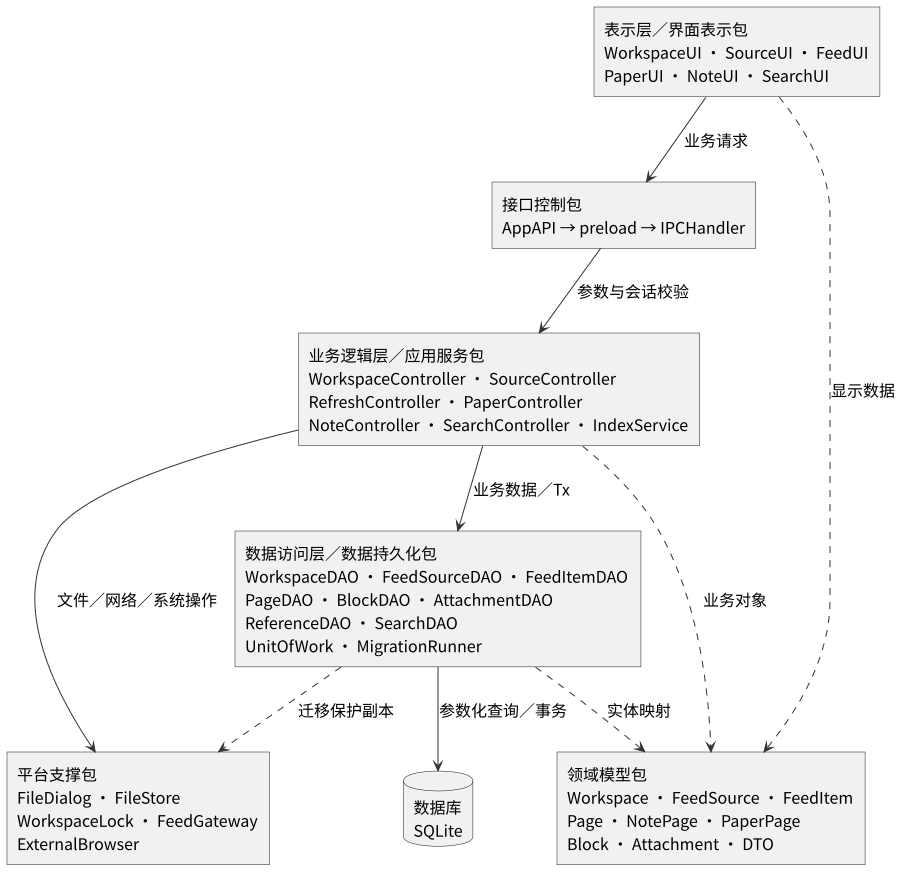

图 2.2 展示各构件的运行位置。渲染进程负责交互，主进程持有工作区连接、锁及受管文件入口；订阅来源和系统浏览器通过平台服务接入。

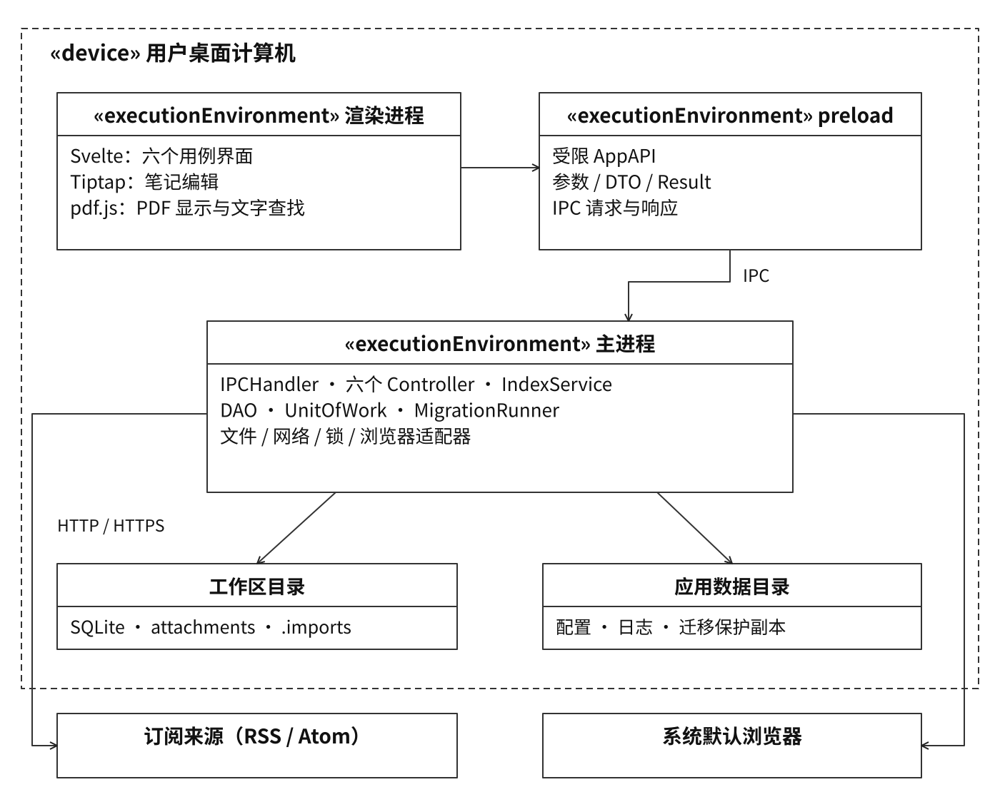

## 3. 数据设计

### 3.1 实体类设计

#### 3.1.1 Workspace（工作区）

| 属性 | 类型 | 说明 |
| --- | --- | --- |
| id | UUID | 工作区稳定标识 |
| name | String | 显示名称 |
| rootPath | String | 当前打开目录的规范化路径，由会话维护 |
| schemaVersion | Integer | 当前数据库结构版本 |
| createdAt | Timestamp | 创建时间 |

#### 3.1.2 FeedSource（订阅源）

| 属性 | 类型 | 说明 |
| --- | --- | --- |
| id | UUID | 来源标识 |
| name、url | String | 来源名称和订阅地址 |
| lastRefreshedAt | Timestamp? | 最近一次成功刷新时间 |
| status | SourceStatus | 界面状态：正常、刷新中、抓取失败 |

#### 3.1.3 FeedItem（订阅条目）

| 属性 | 类型 | 说明 |
| --- | --- | --- |
| id | UUID | 条目标识 |
| sourceId | UUID? | 当前来源关联 |
| sourceName | String | 首次保存的来源名称快照 |
| title、url、summary | String | 标题、可用原文链接和摘要 |
| publishedAt | Timestamp? | 来源提供的发布时间 |
| fetchedAt | Timestamp | 首次获取时间 |
| isRead | Boolean | 已读状态 |

#### 3.1.4 Page、NotePage、PaperPage（页面及子类）

| 类 | 属性 | 类型与说明 |
| --- | --- | --- |
| Page | id、kind、title | UUID、页面类型、标题；kind 取 note 或 paper |
| Page | createdAt、updatedAt、version | 创建时间、更新时间、持久化版本号 |
| NotePage | blocks、paperIds | 页内有序内容块集合、引用文献标识集合 |
| PaperPage | authors、doi、attachmentId | 作者信息、DOI、PDF 附件标识；作者和 DOI 可为空 |

NotePage 和 PaperPage 继承 Page 的标识、标题及时间属性。笔记正文以 Block 集合保存，文献页通过 attachmentId 定位受管副本。

#### 3.1.5 Block（内容块）

| 属性 | 类型 | 说明 |
| --- | --- | --- |
| id、pageId | UUID | 内容块标识、所属笔记标识 |
| order | Integer | 页内顺序，从 0 开始连续排列 |
| type | BlockType | 段落、标题或列表 |
| content | JSON | 文本、格式及行内文献链接 |

#### 3.1.6 Attachment（附件）

| 属性 | 类型 | 说明 |
| --- | --- | --- |
| id、paperId | UUID | 附件标识、所属文献标识 |
| relativePath | String | 工作区内的受管相对路径 |
| originalName | String | 导入时的文件名 |
| size | Integer | 文件字节数 |
| mediaType | String | application/pdf |

### 3.2 数据库表设计

每个工作区包含一个 SQLite 数据库，连接打开时启用外键检查。UUID 使用 TEXT，时间使用 UTC Unix 毫秒整数，布尔值使用 0 和 1。页面类型和内容块类型以枚举检查约束保存。

#### 3.2.1 工作区与迁移表

| 表 | 字段 | 键与规则 |
| --- | --- | --- |
| workspace_meta | singleton INTEGER；id TEXT；name TEXT；created_at INTEGER | singleton 为主键且值为 1；id 唯一 |
| schema_migrations | version INTEGER；checksum TEXT；applied_at INTEGER | version 为主键；保存每次已完成迁移的版本和校验值 |

工作区目录在运行时解析。schemaVersion 取 schema_migrations 中已完成迁移的最大版本。迁移前在应用数据目录生成数据库保护副本；迁移过程使用事务，成功后记录版本，失败时回滚并保留保护副本。

#### 3.2.2 订阅数据表

| 表 | 字段 | 键与规则 |
| --- | --- | --- |
| feed_sources | id TEXT；name TEXT；url TEXT；last_refreshed_at INTEGER? | id 为主键；url 唯一 |
| feed_items | id TEXT；source_id TEXT?；source_name TEXT；title TEXT；url TEXT；summary TEXT；published_at INTEGER?；fetched_at INTEGER；is_read INTEGER | id 为主键；url 唯一；source_id 引用 feed_sources.id，删除来源时 SET NULL |

移除来源时，外键将 feed_items.source_id 置空，source_name 和 is_read 保持原值。条目首次保存后使用其 id 维持阅读状态。列表按 coalesce(published_at, fetched_at) 降序、id 升序排列；每次列表查询固定该次浏览的条目顺序，用户刷新列表后建立新快照。

#### 3.2.3 页面、内容块和引用表

| 表 | 字段 | 键与规则 |
| --- | --- | --- |
| pages | id TEXT；kind TEXT；title TEXT；created_at INTEGER；updated_at INTEGER；version INTEGER | id 为主键；kind 为 note 或 paper；version 从 1 开始 |
| paper_metadata | page_id TEXT；authors TEXT；doi TEXT | page_id 为主键并引用 pages.id；authors、doi 默认空字符串 |
| blocks | id TEXT；page_id TEXT；position INTEGER；type TEXT；content_json TEXT | id 为主键；page_id 引用 pages.id；(page_id, position) 唯一；position 非负 |
| note_paper_refs | note_id TEXT；paper_id TEXT | (note_id, paper_id) 为复合主键；两字段引用 pages.id |

NoteController 校验块所属页面、顺序连续性和引用目标类型。保存时在同一事务中更新标题，按当前页整体替换块集合和引用集合，并增加 pages.version。块重排沿用原 id；新增块获得新 UUID。content_json 中的行内文献链接与 note_paper_refs 同步生成。

#### 3.2.4 附件表

| 表 | 字段 | 键与规则 |
| --- | --- | --- |
| attachments | id TEXT；paper_id TEXT；relative_path TEXT；original_name TEXT；size INTEGER；media_type TEXT | id 为主键；paper_id 唯一并引用 pages.id；relative_path 唯一；size 非负 |

附件相对路径采用 attachments/<attachmentId>.pdf。每次导入生成新的 paperId 和 attachmentId，并复制文件到对应路径。数据库事务提交后，文献页和附件关联一起进入可见状态。

#### 3.2.5 检索表与索引

| 表 | 字段 | 键与规则 |
| --- | --- | --- |
| search_documents | kind TEXT；target_id TEXT；title TEXT；search_text TEXT；updated_at INTEGER | (kind, target_id) 为复合主键；保存检索文本和显示标题 |
| search_terms | term TEXT；kind TEXT；target_id TEXT | 三字段为复合主键，按 term 查找候选对象；文档关联使用复合外键 |
| index_queue | kind TEXT；target_id TEXT；revision INTEGER | (kind, target_id) 为复合主键；同一目标保留最新更新任务 |
| index_state | singleton INTEGER；status TEXT；generation INTEGER | 单行记录；status 为 BUILDING、READY 或 FAILED |

索引文本包括笔记标题和正文、文献标题和作者／DOI、订阅条目标题和摘要。IndexService 统一处理大小写、空白和 Unicode 规范化，中文建立单字及连续双字词项，拉丁文字按词项建立索引。查询使用同一分词规则，求词项候选集后核对连续关键词并提取片段。

表 3.1 访问索引

| 索引 | 访问场景 |
| --- | --- |
| feed_sources(url) UNIQUE | 来源地址查重 |
| feed_items(url) UNIQUE | 工作区内原文链接去重 |
| feed_items(source_id) | 按来源筛选及来源移除 |
| feed_items(coalesce(published_at, fetched_at) DESC, id) | 条目排序及分页 |
| pages(kind, updated_at DESC, id) | 笔记和文献列表 |
| blocks(page_id, position) UNIQUE | 按页恢复正文顺序 |
| note_paper_refs(paper_id, note_id) | 文献引用反查 |
| attachments(paper_id) UNIQUE | 文献打开时定位附件 |
| search_terms(term, kind, target_id) PRIMARY KEY | 关键词和类型过滤 |

首次打开时，索引服务扫描可检索数据并构建索引，完成后设为 READY。后续业务事务同步写入 index_queue；索引服务读取待处理任务，以事务更新检索文档和词项，并按已处理 revision 清除任务。处理期间到达的新 revision 留待下一批执行。

### 3.3 实体类与数据库表的映射关系

| 实体类 | 数据表 | 映射方式 |
| --- | --- | --- |
| Workspace | workspace_meta、schema_migrations | 工作区属性及结构版本组合读取 |
| FeedSource | feed_sources | 一条记录对应一个来源；刷新状态由会话维护 |
| FeedItem | feed_items | 一条记录对应一个条目 |
| Page | pages | 保存页面公共属性 |
| NotePage | pages、blocks、note_paper_refs | kind=note；组合读取正文和引用 |
| PaperPage | pages、paper_metadata、attachments | kind=paper；组合读取文献信息和附件 |
| Block | blocks | 一条记录对应一个内容块 |
| Attachment | attachments | 一条记录对应一个受管 PDF |

### 3.4 DAO 与表映射关系

| DAO | 管理的表 |
| --- | --- |
| WorkspaceDAO／MigrationRunner | workspace_meta／schema_migrations |
| FeedSourceDAO | feed_sources |
| FeedItemDAO | feed_items |
| PageDAO | pages、paper_metadata |
| BlockDAO | blocks |
| AttachmentDAO | attachments |
| ReferenceDAO | note_paper_refs |
| SearchDAO | search_documents、search_terms、index_queue、index_state |

### 3.5 数据设计类图

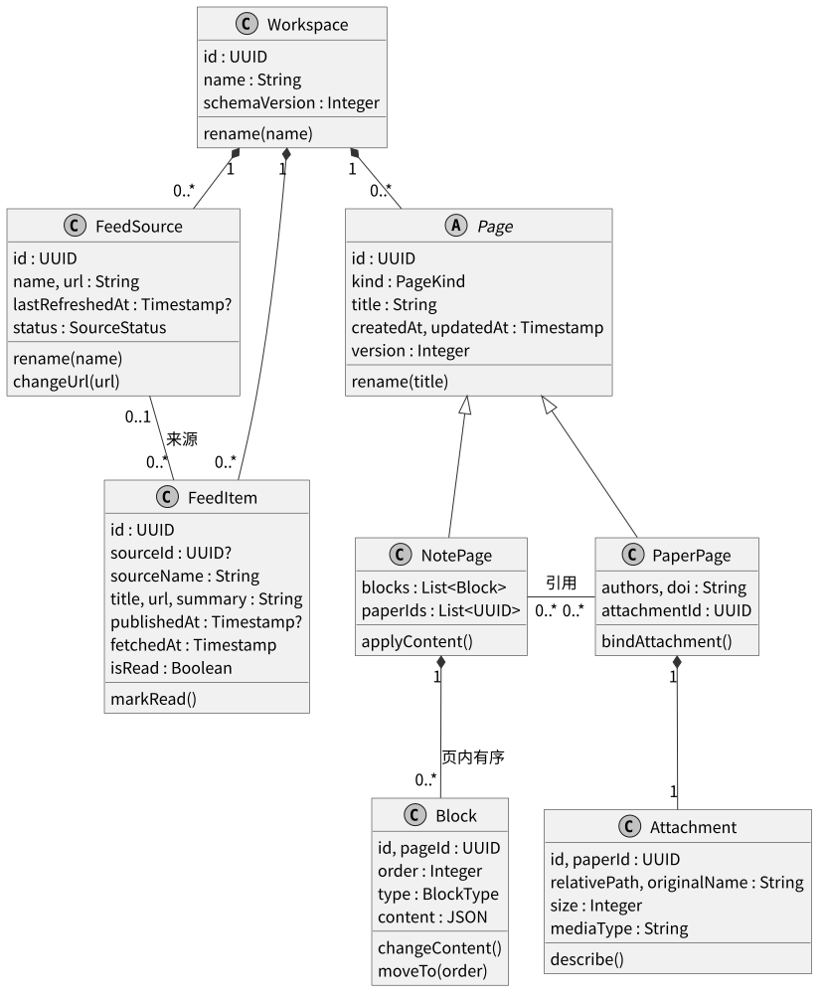

Workspace 组合管理来源、条目和页面。FeedItem 可关联一个来源，来源移除后该关联为空。NotePage 组合拥有有序内容块，并通过引用关系关联 PaperPage；PaperPage 组合拥有一个 Attachment。

## 4. 接口设计

### 4.1 边界类接口

六个 UI 按表 2.5 接收用户操作。跨进程接口统一位于 window.labloom 下，由 preload 公开表 4.1 中的方法。

表 4.1 AppAPI 与控制器映射

| AppAPI 方法组 | 公开方法 | 接收控制器 |
| --- | --- | --- |
| workspace | create(name)、open()、close() | WorkspaceController |
| sources | list(sessionId)、add(sessionId, input)、update(sessionId, id, input)、remove(sessionId, id) | SourceController |
| feed | refresh(sessionId, sourceId?)、list(sessionId, filter, page)、read(sessionId, id)、openOriginal(sessionId, id) | RefreshController |
| papers | importPDF(sessionId)、list(sessionId, page)、readPDF(sessionId, paperId) | PaperController |
| notes | create(sessionId, title)、list(sessionId, page)、load(sessionId, id)、save(sessionId, input) | NoteController |
| search | status(sessionId)、rebuild(sessionId)、query(sessionId, input) | SearchController |

FileDialog 提供 chooseDirectory(mode): Result<DirectorySelection> 和 choosePDF(): Result<FileSelection>，由控制器在主进程调用。FeedGateway 提供 fetchAndParse(url, timeoutMs): Result<ParsedFeed>，供来源校验和订阅刷新使用。PaperUI 从 readPDF 返回的 PDFResource 获取附件字节和显示名称，再调用阅读组件完成渲染。

### 4.2 控制类接口

表 4.2 主要参数及返回数据

| 类型 | 字段 |
| --- | --- |
| WorkspaceSession | sessionId、workspaceId、name、indexStatus |
| SourceInput | name、url |
| FeedFilter | sourceId?、unreadOnly、queryId?；queryId 用于固定当前列表顺序 |
| RefreshSummary | 各来源的 sourceId、success、added、duplicate、skipped、code |
| NoteSnapshot | pageId、title、blocks、paperIds、version |
| NoteSaveInput | pageId、title、blocks、baseVersion、clientRevision；paperIds 从正文链接提取 |
| SaveReceipt | pageId、version、clientRevision、savedAt |
| SearchInput | keyword、scope、page、queryId?；scope 为 all、note、paper 或 feed |
| SearchHit | kind、targetId、title、snippet |
| IndexStatus | status、processed、total、generation |
| PDFResource | attachmentId、originalName、bytes |

Result.success 表示操作结果；code 使用稳定错误代码；msg 对应简体中文消息；data 保存成功结果。分页大小固定为 50，page 从 1 开始。搜索首次查询生成 queryId，将按类型、匹配等级和 targetId 排序的结果标识保存在当前会话，后续翻页使用同一顺序；queryId 在用户更换条件、重新搜索或关闭会话时释放。后续翻页同时校验 queryId 对应的关键词与范围。

表 4.3 错误返回

| code | 触发条件 | 界面处理 |
| --- | --- | --- |
| CANCELLED | 取消文件或目录选择 | 返回原界面 |
| INVALID_ARGUMENT | 参数格式、类型或页码无效 | 标记对应输入项 |
| INVALID_SESSION | 工作区会话已失效 | 返回工作区选择界面 |
| WORKSPACE_BUSY | 目录已由其他实例打开 | 显示占用状态 |
| WORKSPACE_INVALID／MIGRATION_FAILED | 工作区结构校验失败／迁移失败 | 显示原因及可选目录 |
| SOURCE_DUPLICATE／PROTOCOL_REJECTED | 来源地址重复／协议校验失败 | 保留表单并显示原因 |
| NETWORK_TIMEOUT／NETWORK_FAILED／FEED_INVALID | 请求超时／网络失败／解析失败 | 显示来源失败状态及重试入口 |
| PDF_INVALID／FILE_UNAVAILABLE／DISK_FULL | PDF 无效／附件不可用／空间不足 | 保留列表并显示处理结果 |
| STORAGE_FAILED | 数据库或文件写入失败 | 保留当前输入，提供重试入口 |
| VERSION_CONFLICT | 保存基线与数据库版本不同 | 保留草稿，显示重新读取与复制草稿入口 |
| INDEX_NOT_READY／INDEX_FAILED | 索引构建中／构建失败 | 显示构建进度或重建入口 |
| QUERY_EXPIRED／TARGET_NOT_FOUND | 查询快照失效／目标已失效 | 刷新查询或返回列表 |

PDF 阅读密码由阅读组件在内存中处理。错误密码显示重新输入入口，取消密码输入则关闭当前阅读视图，文献记录与附件保持原值。

### 4.3 DAO 接口

DAO 按表 2.7 提供操作。PageDAO.updateNote 以 pageId 和 expectedVersion 匹配更新目标，成功后 version 增加 1；匹配失败返回版本冲突。BlockDAO.replaceByPage 在当前事务中删除该页原块记录并按新顺序插入，保留传入块标识；其他页面的块标识由全局主键和控制器校验共同保护。

ReferenceDAO.replaceByNote 保存去重后的文献目标集合。FeedItemDAO.insert 使用 url 唯一约束处理重复条目，重复时保留原记录。SearchDAO.enqueue 与业务写入共享 Tx。事务失败时，各 DAO 的写入共同回滚。

### 4.4 实体类接口

实体操作见表 2.8。控制器读取实体后执行校验和状态变更，再调用 DAO 保存。NotePage.applyContent 按 order 组织内容块，提取行内文献链接并形成引用集合；PaperPage.bindAttachment 将新附件与文献标识配对。显示数据经 DTO 转换交给界面。

### 4.5 接口交互顺序图

#### 4.5.1 UC01 创建或打开工作区顺序图

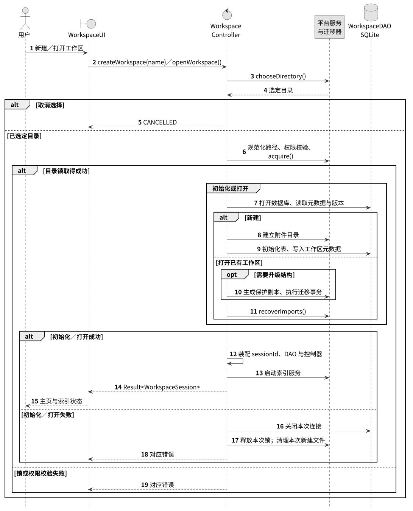

创建流程取得目录锁后完成数据库初始化和元数据写入；打开流程完成结构检查、迁移和附件恢复清理。成功后装配工作区会话并启动索引，失败时关闭连接并释放本次取得的锁。

#### 4.5.2 UC02 管理订阅源顺序图

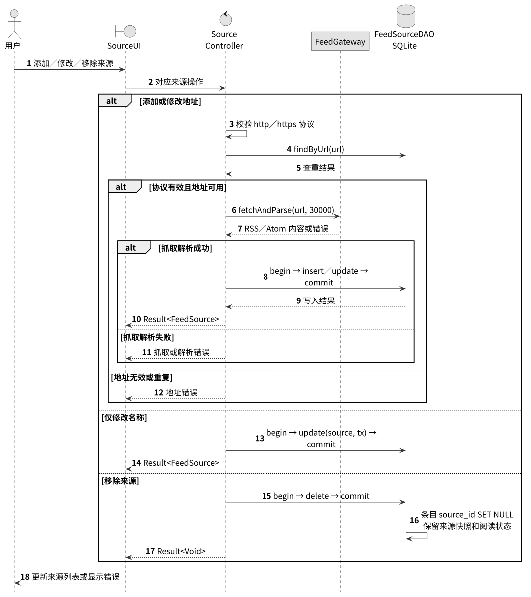

添加和修改地址先校验协议、重复地址及订阅内容，成功后写入。仅修改名称时直接保存名称。移除操作在事务中删除来源记录，数据库按外键规则清空条目来源关联并保留历史内容。

#### 4.5.3 UC03 刷新与阅读订阅顺序图

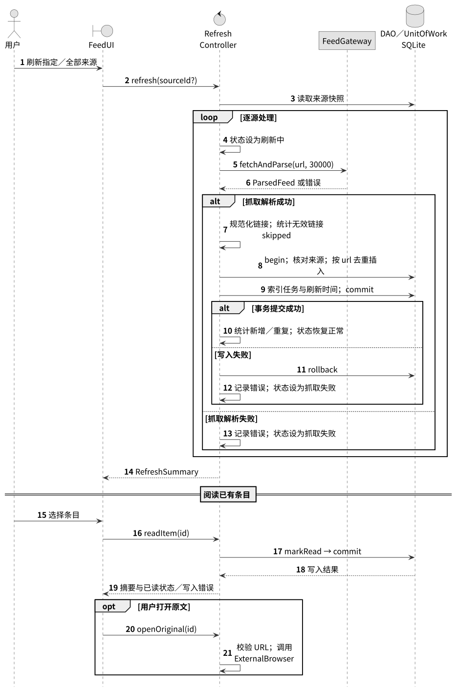

刷新全部来源时逐源执行抓取和保存，汇总新增、重复、跳过及失败数量。阅读条目时先持久化已读状态，再返回摘要；打开原文时重新校验保存的 URL 并调用系统浏览器。

#### 4.5.4 UC04 导入与阅读 PDF 顺序图

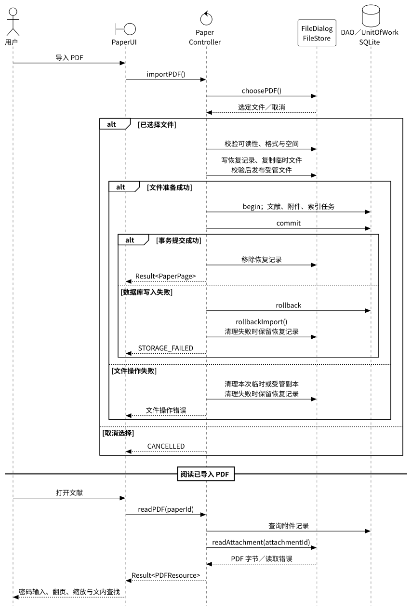

FileStore 先生成临时副本，完成校验后发布受管文件，再由控制器提交文献和附件记录。提交失败时删除本次受管文件；清理失败的操作保留恢复记录，在下次打开工作区时继续处理。

#### 4.5.5 UC05 编辑与保存笔记顺序图

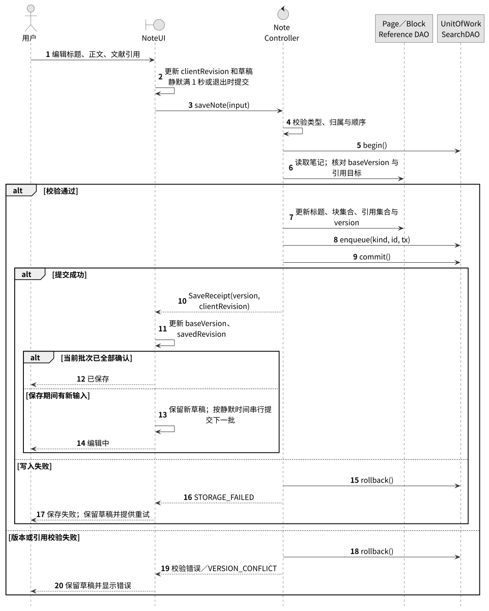

NoteUI 在停止输入满 1 秒时提交当前编辑快照。保存返回的 clientRevision 与提交批次对应，界面据此更新 savedRevision；期间产生的新编辑继续保持编辑状态，并在下一次静默期提交。

#### 4.5.6 UC06 检索资料顺序图

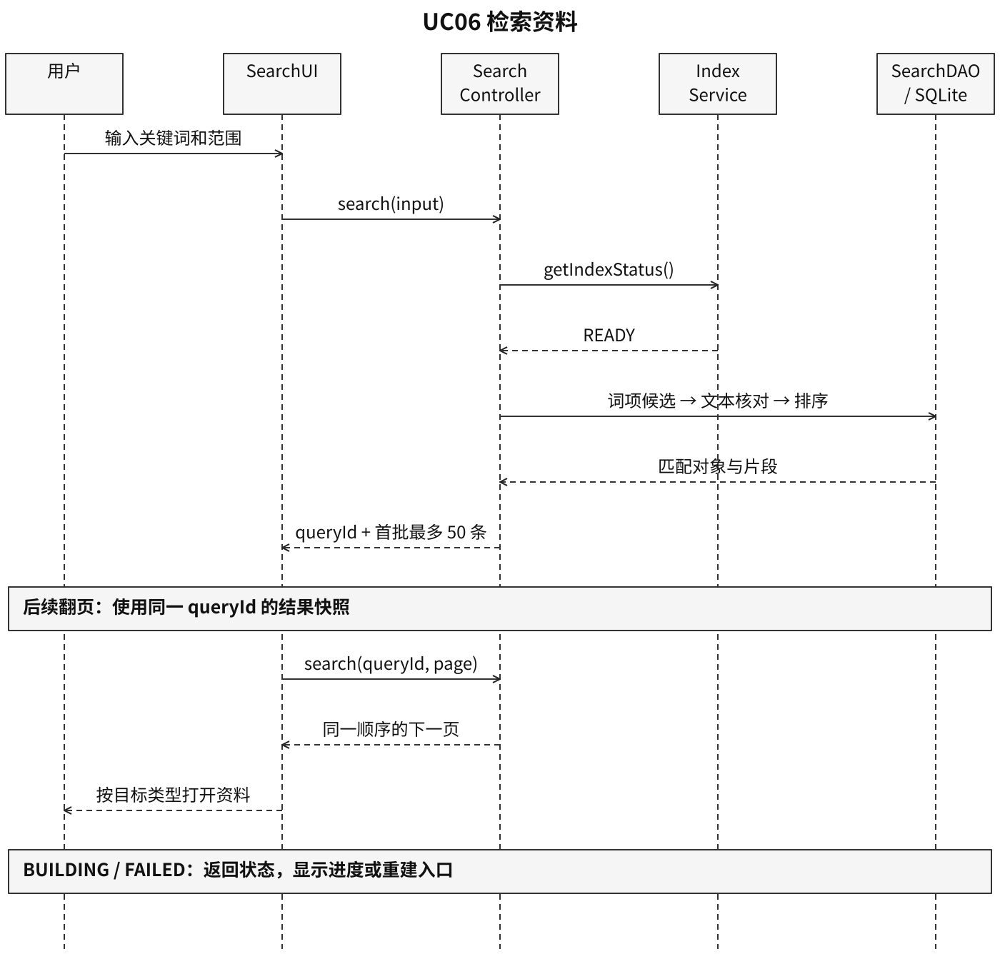

SearchController 检查索引状态并查询候选对象，核对匹配文本后建立结果快照。SearchUI 按类型显示结果，用户选择后交给 NoteUI、PaperUI 或 FeedUI 打开目标。

## 5. 构件级设计

### 5.1 构件列表

| 构件组 | 类型 | 实现接口 | 协作对象 |
| --- | --- | --- | --- |
| 六个 UI | 边界构件 | 表 2.5 中的 UI 接口 | AppAPI、编辑器、阅读组件 |
| 六个 Controller | 控制构件 | 表 2.6 中的 Controller 接口 | DAO、实体、UnitOfWork、平台服务 |
| 八个 DAO | 持久化构件 | 表 2.7 中的 DAO 接口 | SQLite Connection／Tx |
| 八个实体类 | 数据及领域对象 | 表 2.8 中的实体操作 | DTO 映射与控制器 |
| IndexService | 后台服务 | IIndexService | 检索 DAO、页面和订阅读取接口 |
| UnitOfWork、MigrationRunner | 存储支撑构件 | IUnitOfWork、IMigrationRunner | 数据库连接、保护副本 |
| FileDialog、FileStore、WorkspaceLock、FeedGateway、ExternalBrowser | 平台构件 | 对应平台接口 | 文件系统、网络、操作系统 |

### 5.2 构件级类图

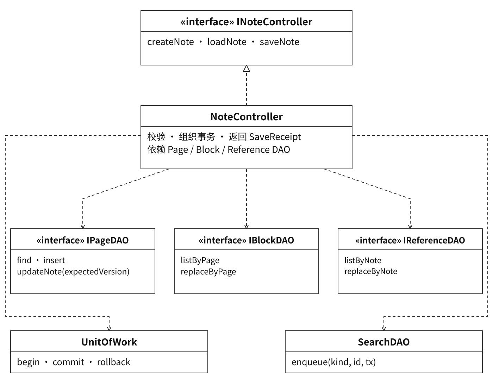

NoteController 实现 INoteController，使用三个业务 DAO 和 SearchDAO 完成保存。UnitOfWork 为这些写入提供共同事务。NotePage、Block 和 PaperPage 提供数据对象及类型约束。

### 5.3 关键构件详细设计

#### 5.3.1 WorkspaceController.openWorkspace

输入：用户在目录选择窗口中选定的目录。

输出：Result<WorkspaceSession>。

1. FileDialog 返回用户选择；取消时返回 CANCELLED。
2. 规范化路径，校验目录权限，WorkspaceLock 取得该目录的独占锁。
3. 打开数据库，读取工作区标识和结构版本；版本较旧时生成保护副本并执行迁移事务。
4. 读取导入恢复记录，清理临时文件和数据库中无对应附件记录的待恢复文件。
5. 创建 sessionId，装配 DAO、控制器和索引服务，返回工作区信息及索引状态。
6. 任一步骤失败时关闭本次连接、释放本次锁并返回对应错误。

新建工作区使用同样的目录选择与锁流程，在新目录中建立数据库、元数据及附件目录后装配会话。创建失败时清理本次产生的文件。

#### 5.3.2 SourceController.addSource／updateSource／removeSource

输入：来源名称、地址，修改和移除操作同时传入来源 id。

输出：来源对象或操作结果。

1. 解析 URL，校验 http／https 协议，并按解析后的规范形式执行地址查重。
2. 添加或地址变更时调用 FeedGateway；请求总超时为 30 秒，重定向的每个地址均执行协议校验。
3. 解析 RSS 2.0 或 Atom 1.0，按 XML 编码声明解码；缺省使用 UTF-8。
4. 校验成功后打开事务，插入或更新来源；仅名称变更直接进入此步骤。
5. 移除来源时打开事务并删除来源记录，关联条目的 source_id 由外键更新为空。
6. 提交后返回最新来源列表所需数据；失败则回滚并返回错误。

一次请求失败后结束该次访问，后续访问由用户手动发起。名称修改和来源移除使用本地数据库完成。

#### 5.3.3 RefreshController.refresh

输入：指定来源 id，或全部来源。

输出：RefreshSummary。

1. 取得来源快照，将每个来源的运行状态设为刷新中。
2. 逐源抓取和解析内容，将相对原文链接按响应地址解析为绝对地址，校验 http／https 后生成规范化链接。
3. 对缺少可用链接的条目累计 skipped；对其余条目生成候选数据。
4. 进入该来源的写入事务，重新核对来源仍存在，按 url 唯一键插入新条目，保留首次来源快照和已存在条目的阅读状态。
5. 将新条目加入 index_queue，更新成功刷新时间，提交事务。
6. 失败时回滚该来源事务，记录错误并继续处理其他来源，最后返回汇总结果。

#### 5.3.4 PaperController.importPDF

输入：用户选择的本地 PDF。

输出：Result<PaperPage>。

1. 通过 FileDialog 选择文件，检查可读性、PDF 结构和目标磁盘空间；加密 PDF 记录加密状态并进入复制流程。
2. 生成 paperId、attachmentId 和 importId，在 .imports 中持久化恢复记录，记下本次临时路径和最终相对路径。
3. 将原文件复制到临时文件，完成字节数和格式校验，再以同盘重命名发布到 attachments/<attachmentId>.pdf。
4. 打开数据库事务，插入文献页、文献元数据、附件记录和索引任务，提交事务。
5. 删除恢复记录，返回文献页并更新列表。
6. 文件或数据库操作失败时回滚本次数据库事务，删除本次复制文件；清理未完成时保留恢复记录。

再次打开工作区时，恢复流程按 attachmentId 查询数据库：记录存在且文件完整时保留受管副本；记录缺失时删除该次临时及已发布文件，再移除恢复记录。重复导入时按同样流程生成独立标识和副本。

#### 5.3.5 NoteController.saveNote

输入：NoteSaveInput。

输出：Result<SaveReceipt>。

1. 校验页面类型、块标识、块归属、正文类型和页内顺序，提取文献引用集合。
2. 开始事务，读取笔记并核对 baseVersion；校验每个引用目标的文献类型。
3. 更新标题、updated_at 和 version，替换当前页的内容块及文献引用，写入索引任务。
4. 提交事务，返回新 version、clientRevision 和 savedAt。
5. 失败时回滚，返回 VERSION_CONFLICT 或 STORAGE_FAILED。

同一笔记的提交由 NoteUI 串行组织。保存期间的输入更新待提交快照；上一批成功后采用返回的新 version 提交下一批。若最近一次输入的 1 秒静默期已经结束，则立即提交；否则等待剩余静默时间。正常退出前立即提交待保存内容，成功后继续关闭流程；失败时保持窗口并提供重试或放弃本次编辑的操作。

#### 5.3.6 SearchController.search／IndexService

输入：关键词、范围、页码及可选 queryId。

输出：Result<PageResult<SearchHit>>。

1. 检查关键词和索引状态，构建中返回 INDEX_NOT_READY，构建失败返回 INDEX_FAILED。
2. 首次查询规范化关键词并分词，通过 search_terms 查询候选对象，以 search_documents 中的文本核对匹配并生成片段。
3. 按 note、paper、feed 类型顺序分组，组内按标题命中优先、正文命中其次及 targetId 升序排列。
4. 在主进程保存该次结果快照，生成 queryId，返回指定页的最多 50 条结果及 hasMore。
5. 后续翻页核对 queryId、关键词和范围，读取同一快照；失效时返回 QUERY_EXPIRED。

IndexService 在首次构建时记录进度，完成后增加 generation 并设置 READY。增量更新读取 index_queue 中的最新任务，重新生成目标文本和词项，以事务替换检索文档。写入失败时保留任务，状态中记录失败信息，并提供重建操作入口。

### 5.4 状态图

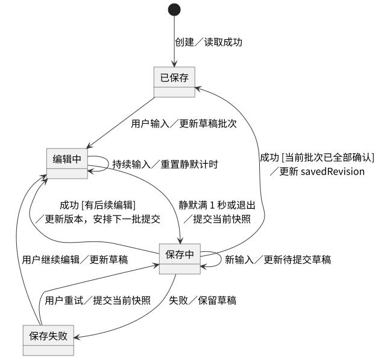

笔记创建或读取成功后进入已保存状态；用户输入后进入编辑中；静默期结束或退出触发保存。写入成功且当前输入批次已被确认时进入已保存，存在后续编辑时回到编辑中；失败时进入保存失败并保留草稿。

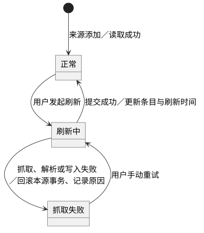

来源进入刷新中后，成功则更新刷新时间并恢复正常，失败则进入抓取失败。用户重试重新进入刷新中，历史条目在各状态下均可读取。

## 6. 用户界面设计

### 6.1 设计目标与原则

#### 6.1.1 设计目标

界面围绕工作区、订阅、文献、笔记和检索组织操作，使资料获取、阅读、记录和再次查找形成连续路径。关键操作提供加载、成功及失败反馈；编辑内容在保存完成前保持可见。

#### 6.1.2 设计原则

| 原则 | 设计方式 |
| --- | --- |
| 一致性 | 六个用例采用统一的标题、列表、表单、操作按钮及状态文字 |
| 输入简化 | 工作区和 PDF 路径通过选择窗口输入；文献引用通过已有文献列表选择 |
| 状态可见 | 刷新、导入、索引和保存状态显示在对应操作区域 |
| 容错性 | 校验失败保留输入；移除来源前显示确认对话框 |
| 键盘操作 | Tab 顺序连接输入项，Enter 提交表单，Esc 关闭可取消对话框 |

### 6.2 界面总体结构

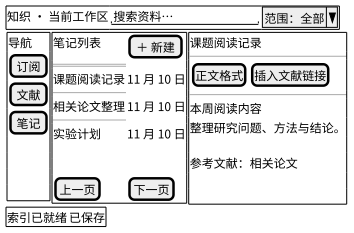

顶部显示工作区名称和搜索入口；左侧提供订阅、文献、笔记入口；中间区域显示来源或资料列表；右侧内容区显示摘要、PDF 或笔记。底部状态栏显示索引进度和当前操作结果。启动时显示工作区选择页，提供新建和打开两个入口。

### 6.3 通用界面元素

| 元素 | 内容与交互 |
| --- | --- |
| 列表 | 标题、类型、来源或更新时间；每页 50 条；上一页、下一页 |
| 表单 | 字段标题、输入框、字段错误、保存与取消 |
| 状态区 | 加载中、刷新中、编辑中、保存中、已保存、保存失败 |
| 确认框 | 操作对象、影响说明、确认与取消 |
| 空结果区 | 显示尚无资料或当前查询无匹配，并提供对应入口 |
| 错误区 | 显示错误原因、保留的输入及重试操作 |

### 6.4 各模块界面设计

| 用例 | 主要界面 | 输入与操作 | 成功与异常反馈 |
| --- | --- | --- | --- |
| UC01 | 工作区选择页 | 名称、选择目录、新建、打开 | 成功进入主页；占用或目录错误停留原页 |
| UC02 | 来源列表及编辑表单 | 名称、URL、保存、移除 | 更新列表；重复地址或网络错误显示在表单 |
| UC03 | 来源筛选、条目列表、摘要区 | 刷新、全部刷新、打开条目、原文 | 新增与跳过数量、逐源失败结果、已读标记 |
| UC04 | 文献列表、PDF 阅读区 | 导入、翻页、缩放、查找、取消查找 | 首屏、页码、匹配数；密码输入及文件错误 |
| UC05 | 笔记列表、标题栏、编辑区 | 新建、改标题、编辑块、插入文献链接 | 保存状态、失败重试、退出确认 |
| UC06 | 搜索框、范围选择、结果列表 | 关键词、范围、分页、打开结果 | 标题与匹配片段；索引进度、空结果和错误 |

文献链接选择器从 papers.list 读取文献标题和标识，选择后在笔记光标位置插入链接。索引状态为 BUILDING 时搜索按钮显示构建状态；READY 后恢复查询。PDF 查找区域在处理期间显示进度并提供取消，取消后保留当前阅读页。

### 6.5 界面交互时序

以 UC05 为例：用户输入 → NoteUI 更新草稿并显示编辑中 → 停止输入满 1 秒 → AppAPI 提交快照 → 显示保存中 → 收到 SaveReceipt → 比较 clientRevision → 显示已保存或继续编辑中。失败时保留草稿并显示重试按钮。图 4.5 和图 5.2 分别描述该交互的对象协作和状态变化。

## 7. 非功能设计

### 7.1 性能设计

表 7.1 性能与容量设计

| 需求 | 目标 | 设计措施 |
| --- | --- | --- |
| NFR-PERF-01 | 工作区选择界面冷启动不超过 5 秒 | 首屏装载基础界面，工作区数据和索引在选定目录后加载 |
| NFR-PERF-02 | 检索首批结果 P95 不超过 1 秒；新文本在 5 秒内可检索 | 词项索引、分类过滤、增量任务、每页 50 条 |
| NFR-PERF-03 | 常规 PDF 首屏不超过 3 秒；邻页 P95 不超过 500 毫秒 | 按页渲染、邻页缓存、异步文字查找及取消 |
| NFR-REL-01 | 静默满 1 秒触发保存；常规提交后 1 秒内完成 | 输入去抖、同页串行提交、标题正文引用一次事务 |
| NFR-CAP-01 | 1 万页面、10 万块、10 万条目、100 来源、1 万附件、附件总量 10 GB | 分页读取、联合索引、附件文件存储、导入前空间检查 |

测量环境采用四核 CPU、8 GB 内存和 SSD。冷启动连续测量 5 次；检索及邻页切换各测量 20 次，P95 取升序第 19 项。保存测试使用 100 个普通文本块、正文约 20 KB 的笔记，分别记录触发耗时和写入耗时。PDF 测量使用不超过 100 页且不超过 50 MB 的含文本文件。

### 7.2 安全性设计

IPCHandler 校验发送窗口、参数类型和 sessionId；FileStore 将附件标识解析到当前工作区目录，核对规范化路径的归属。SQL 使用参数绑定。FeedGateway 校验初始地址和重定向地址的 http／https 协议，ExternalBrowser 打开前再次校验。摘要展示使用安全文本或经过清理的标记内容。PDF 密码在当前阅读会话内使用，关闭阅读时释放。

### 7.3 可用性设计

本地资料的读取、编辑和检索使用工作区数据库及受管附件。来源新增、地址修改和刷新在网络可用时执行，失败返回原因并保留当前数据。笔记标题、正文和引用采用同一事务；PDF 导入采用恢复记录和补偿清理；工作区迁移生成保护副本。来源刷新逐源处理，成功和失败分别汇总。

正常退出等待笔记保存并关闭连接；异常退出后按数据库已提交状态恢复，并执行导入恢复清理。日志记录操作类别、对象标识、时间和错误代码，界面按稳定错误码提供处理入口。

### 7.4 可扩展性设计

六个控制器通过接口组织业务，平台服务和 DAO 提供可替换实现。页面公共属性集中在 Page，笔记与文献按子类扩展。数据库结构按迁移版本演进，迁移清单记录版本和校验值。界面文字集中管理，日期和时间依据系统区域设置显示。

### 7.5 可测试性设计

表 7.2 需求与设计验证对应

| 验收编号 | 设计对象 | 验证内容 |
| --- | --- | --- |
| TC-01、TC-08、TC-13 | WorkspaceController、WorkspaceLock、MigrationRunner | 创建重开、独占访问、异常恢复、冷启动、迁移失败恢复 |
| TC-02、TC-03 | SourceController、RefreshController | 地址校验、历史保留、去重、跳过统计、超时及已读持久化 |
| TC-04、TC-05 | PaperController、FileStore、PaperUI | 重复导入、失败补偿、密码交互、附件缺失、翻页和查找 |
| TC-06 | NoteController、NoteUI、UnitOfWork | 原子保存、后续输入批次、失败重试、退出保存和页内块归属 |
| TC-07 | SearchController、IndexService | 索引状态、文本范围、50 条分页、稳定顺序及增量时延 |
| TC-09、TC-10 | 全部业务控制器 | 容量基线、磁盘不足、离线本地操作 |
| TC-11、TC-12、TC-14 | IPCHandler、平台服务、六个 UI | 协议校验、状态反馈、简体中文和系统日期格式 |

控制器验证使用可替换 DAO、文件和网络接口构造成功与失败场景。数据库集成验证使用独立临时工作区，覆盖唯一键、外键、事务回滚和迁移。界面验证记录用户输入、显示状态和实际持久化结果。

## 8. 部署与实现约束

系统部署为 Windows、macOS 和 Linux 桌面应用。Electron 承载窗口和主进程，Svelte 构建界面，Tiptap 提供笔记编辑，pdf.js 提供 PDF 阅读，SQLite 保存工作区数据。开发工具链采用 Node.js 22 或更高版本、pnpm、TypeScript 和 Git。

表 8.1 运行目录

| 位置 | 内容 | 管理构件 |
| --- | --- | --- |
| 应用安装目录 | 主进程、preload、渲染资源及依赖 | 应用发布包 |
| 应用数据目录 | 应用配置、日志、迁移前数据库保护副本 | 平台服务、MigrationRunner |
| 工作区／workspace.sqlite | 元数据、订阅、页面、内容块、附件记录及检索索引 | DAO、UnitOfWork |
| 工作区／attachments | 以 attachmentId 命名的 PDF 副本 | FileStore |
| 工作区／.imports | 导入临时文件及恢复记录 | FileStore、PaperController |
| 工作区／.workspace.lock | 规范目录标识、持锁进程和启动标记 | WorkspaceLock |

工作区启动顺序为目录校验、取得锁、数据库检查与迁移、导入恢复、服务装配、界面装载和索引构建。目录锁以规范化路径识别同一工作区，取得锁采用原子操作；异常退出遗留记录结合操作系统进程存活信息确认后回收。关闭顺序为保存当前编辑、结束后台任务、关闭数据库、释放锁。

应用安装和升级在对应桌面平台完成，工作区随用户选择的目录保存。发布资源包含 PDF worker、字体及原生 SQLite 依赖。平台验证覆盖启动、文件选择、中文路径、原文浏览器入口和工作区读写。

## 附录：设计图与 PlantUML 源码

设计图采用 PlantUML 建模并渲染。源文件位于 design/plantuml/，对应 SVG 位于 design/figures/，两者使用相同文件主名。主窗口界面结构采用 PlantUML Salt 语法。

| 图号 | 名称 | 图源文件 |
| --- | --- | --- |
| 图 2.1 | 系统体系结构图 | architecture.puml |
| 图 2.2 | 运行部署图 | deployment.puml |
| 图 3.1 | 数据设计类图 | entities.puml |
| 图 4.1 | UC01 工作区顺序图 | uc01.puml |
| 图 4.2 | UC02 来源管理顺序图 | uc02.puml |
| 图 4.3 | UC03 订阅刷新顺序图 | uc03.puml |
| 图 4.4 | UC04 PDF 导入顺序图 | uc04.puml |
| 图 4.5 | UC05 笔记保存顺序图 | uc05.puml |
| 图 4.6 | UC06 检索顺序图 | uc06.puml |
| 图 5.1 | 笔记保存构件级类图 | components.puml |
| 图 5.2 | 笔记保存状态图 | note-state.puml |
| 图 5.3 | 订阅源刷新状态图 | feed-state.puml |
| 图 6.1 | 主窗口界面结构 | interface.puml |
